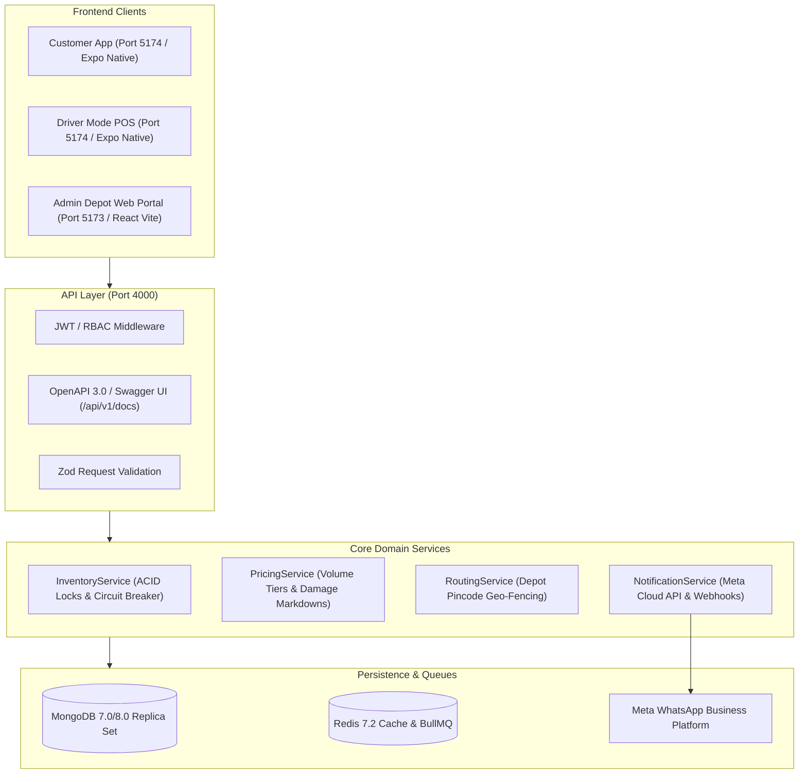
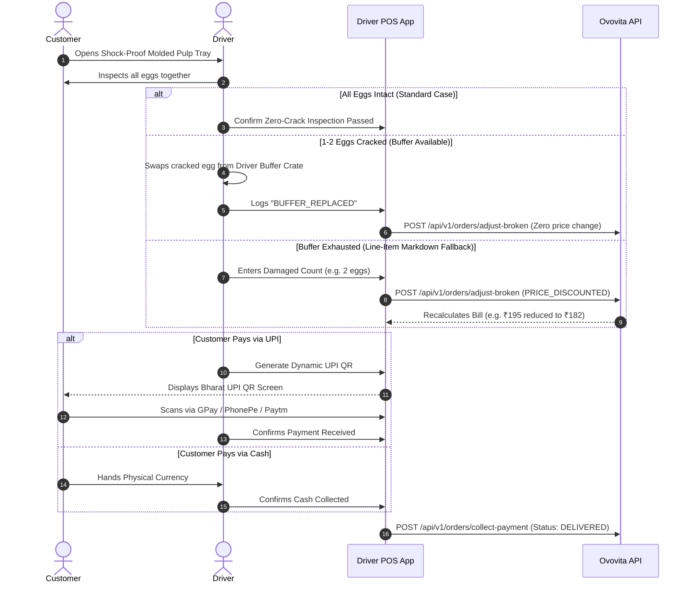

# 🏗️ Ovovita System Architecture & Engineering Handbook

## 1. Architectural Philosophy

Ovovita operates on three core domain guarantees:
1. **Physical Integrity Over Digital Speed:** Fresh eggs cannot be handled like generic ambient goods. Every layer from molded pulp carton packaging to doorstep unboxing contracts is designed to prevent structural failure.
2. **Financial Atomicity (Zero Overselling):** Peak morning ordering (6:00 AM – 7:00 AM) generates extreme contention on limited local farm batches. Inventory decrements must be strictly ACID-compliant.
3. **Dual Cash & Digital Doorstep Reconciliation:** India's grocery delivery market demands cash trust while drivers suffer from cash shrinkage. Ovovita provides a hybrid **Pay-on-Delivery (POD)** engine with Dynamic Bharat UPI QR codes.

---

## 2. High-Level System Architecture



---

## 3. Core Operational Protocols

### 3.1. Atomic Inventory Decrement & Rush Concurrency

To prevent overselling during the morning harvest rush, `InventoryService.atomicDecrementStock` implements dual-mode protection:

- **Replica Set Mode (Production):** Uses MongoDB multi-document ACID transactions (`session.startTransaction()`) across orders and product stocks.
- **Standalone Mode (Local Dev):** Executes atomic conditional `$inc` queries (`{ _id, currentStock: { $gte: requiredEggs } }`) paired with a compensation rollback saga in the `catch` block if any item in a multi-pack order fails.

```typescript
// Atomic conditional decrement pattern
const query = {
  _id: item.productId,
  currentStock: { $gte: item.totalEggsCount },
  status: 'ACTIVE',
};
const update = {
  $inc: { currentStock: -item.totalEggsCount },
};
```

### 3.2. Doorstep Zero-Crack Inspection Protocol



### 3.3. Dynamic Bharat UPI Deep Link Generator

To eliminate digital gateway drop-offs and prevent cash counting delays, Ovovita generates dynamic NPCI UPI deep links directly linked to the order ID:

$$\text{UPI URL} = \text{upi://pay?pa=ovovita.depot@okhdfcbank\&pn=Ovovita+Fresh+Farms\&am=}\text{finalPayableAmount}\text{\&tn=}\text{orderNumber}\text{\&cu=INR}$$

---

## 4. Shift-End Cash Drawer Reconciliation Handshake

When delivery executives return to their assigned hub at the end of a morning or evening shift:

1. **Expected Cash Calculation:**
   $$\text{Expected Cash} = \sum_{\text{Orders}} \text{Payable Amount} \quad [\text{where paymentMethod} = \text{CASH\_ON\_DELIVERY}]$$
2. **UPI Verification:** All digital transactions verified against instant settlement webhook logs.
3. **Variance Audit:**
   $$\text{Variance} = \text{Expected Cash} - \text{Physical Cash Deposited}$$
4. **Digital Sign-off:** If $\text{Variance} = 0$, status is marked `BALANCED`. If a discrepancy exists, supervisory intervention and digital override notes are enforced before the driver is cleared for the day.

---

## 5. Security & Role-Based Access Control (RBAC) Matrix

| Endpoint | Role Required | Purpose |
| :--- | :--- | :--- |
| `POST /auth/customer/*` | Public | Instant OTP request & verification |
| `POST /auth/staff/login` | Public | PIN-based staff login (Shopkeeper, Driver, Admin) |
| `GET /products` | Public | Live egg catalog with unit pricing tiers |
| `PATCH /products/price` | `SHOPKEEPER`, `SYSTEM_ADMIN` | Dynamic live rate adjustments |
| `POST /products/batch-inward` | `SHOPKEEPER`, `SYSTEM_ADMIN` | Depot batch inwards |
| `POST /orders` | `CUSTOMER` | Atomic checkout with stock lock |
| `GET /orders/:id/tracking` | Public / Customer | Live GPS simulation and driver contact card |
| `POST /orders/adjust-broken` | `DELIVERY_EXECUTIVE`, `SHOPKEEPER` | Doorstep zero-crack single-egg adjustments |
| `POST /orders/collect-payment` | `DELIVERY_EXECUTIVE`, `SHOPKEEPER` | Doorstep payment collection & status to DELIVERED |
| `GET /depots/dashboard` | `SHOPKEEPER`, `SYSTEM_ADMIN` | Depot packing queue & active runs |
| `POST /depots/assign-rider` | `SHOPKEEPER`, `SYSTEM_ADMIN` | Rider assignment for delivery run |
| `GET /depots/driver/run-sheet` | `DELIVERY_EXECUTIVE` | Driver's assigned runs only (strict data isolation) |
| `POST /depots/shift/reconciliation-close`| `SHOPKEEPER`, `SYSTEM_ADMIN` | End-of-shift cash drawer balance and sign-off |
| `GET/POST /webhooks/whatsapp` | Public (Meta Verified) | Meta Cloud API challenge & inbound tracking bot |

---

## 6. Zero-Crack Molded Pulp Packaging Standards

- **Material:** 100% biodegradable virgin molded paper pulp.
- **Drop-Test Tolerance:** Withstands vertical drops up to 1.2 meters without shell micro-fractures.
- **Airflow Cavities:** 8 interior ventilation wells per tray to prevent condensation and shell salmonella colonization.
- **Cost Policy:** Packaging fee is ₹0 (100% absorbed by Ovovita as part of the Zero-Crack brand contract).
